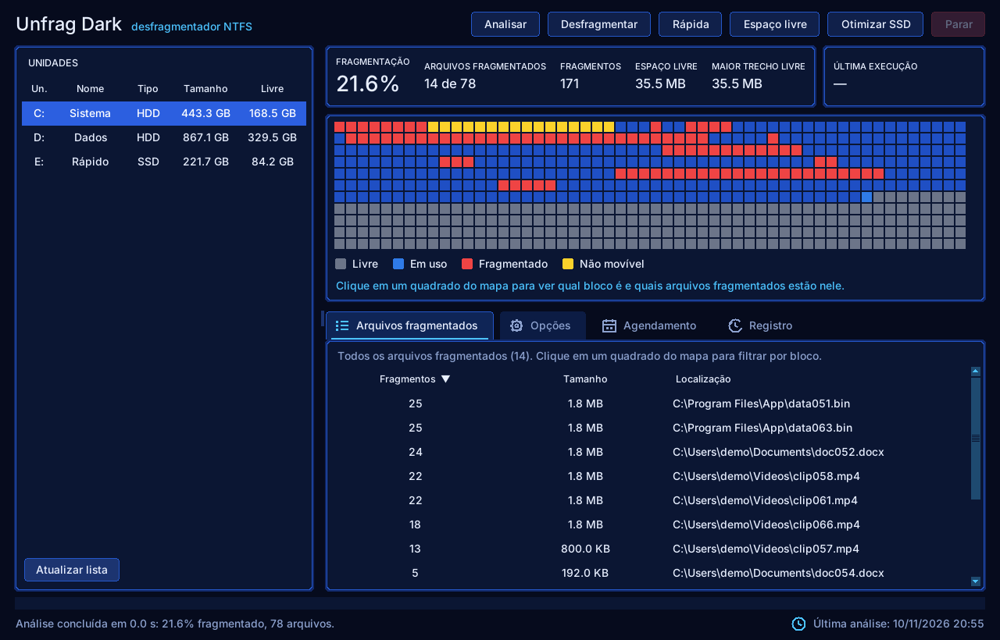
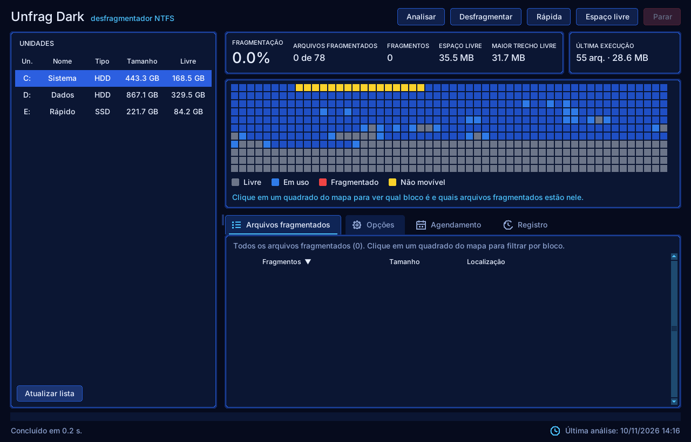
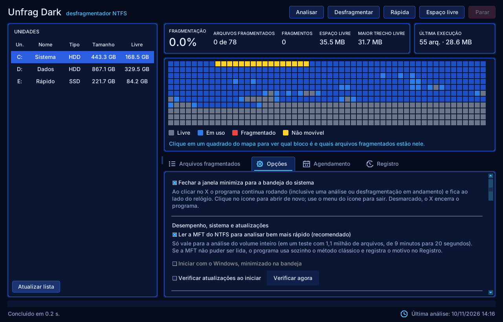

# Unfrag Dark


Desfragmentador de disco **NTFS** para Windows, de código aberto, com **tema escuro**.
Projeto independente, escrito do zero em Python (sem código, nome, ícones ou textos de terceiros).
Foi inspirado, em termos de *funcionalidades*, em desfragmentadores clássicos para PC.





> As capturas usam o **modo demo** (volumes simulados), por isso funcionam em qualquer sistema.

## Funções

| Função | GUI | CLI |
|---|---|---|
| Listar unidades (tipo HDD/SSD, sistema de arquivos, espaço livre) | ✔ | `unfrag list` |
| Analisar fragmentação sem alterar nada | Analisar | `unfrag analyze C:` |
| Desfragmentar (completo) | Desfragmentar | `unfrag defrag C:` |
| Desfragmentação rápida (arquivos até 256 MiB) | Rápida | `--mode quick` |
| Consolidar espaço livre | Espaço livre | `--mode freespace` |
| Desfragmentar uma pasta ou um arquivo | Opções / botão direito na lista | `--path "C:\Pasta"` |
| Mover arquivos grandes / por extensão para o fim do disco | Opções | `--move-large 500` / `--move-ext .iso,.vhdx` |
| Mapa de disco colorido (livre / em uso / fragmentado / não movível) | ✔ | — |
| Lista de arquivos fragmentados (ordenável) | ✔ | — |
| Proteção para SSD (ignora, a menos que forçado) | ✔ | `--force-ssd` |
| Só executar se a fragmentação for ≥ X% | ✔ | `--min-frag 10` |
| Não executar na bateria / se certos processos estiverem rodando | ✔ | `--skip-battery` / `--exclude app.exe` |
| Desligar o PC ao terminar | ✔ | `--shutdown` |
| Agendamento (diário/semanal/mensal) via Agendador de Tarefas | Agendamento | `unfrag schedule create C:` |
| Parar a qualquer momento (cancelamento seguro) | Parar | Ctrl+C |

## Como funciona

Usa as IOCTLs documentadas do Windows para desfragmentação online, as mesmas que a Microsoft
descreve na documentação de *Defragmenting Files*:

* `FSCTL_GET_VOLUME_BITMAP` – mapa de clusters livres/ocupados;
* `FSCTL_GET_RETRIEVAL_POINTERS` – extents de cada arquivo;
* `FSCTL_MOVE_FILE` – o próprio NTFS move os clusters, mantendo a integridade dos dados;
* `IOCTL_STORAGE_QUERY_PROPERTY` – detecta SSD (sem penalidade de seek).

O algoritmo (em `src/unfrag/engine.py`) é próprio: arquivos fragmentados são regravados em uma única
corrida livre (first-fit, menores primeiro); o modo *espaço livre* ainda puxa arquivos do fim do volume
para os primeiros buracos, em até 4 passadas; arquivos grandes podem ser empurrados para o fim.
Arquivos de sistema, esparsos, criptografados (EFS), compactados pelo NTFS e pontos de reanálise
nunca são tocados.

## Instalação e uso

Requer Windows 10/11 e Python 3.10+ (ou use o `.exe` gerado pelo CI em *Actions → build → Artifacts*).

```bat
pip install .
unfrag gui                 :: interface gráfica (execute como Administrador)
unfrag list
unfrag analyze C:
unfrag defrag C: --mode quick
unfrag defrag D: --mode freespace --move-large 1000 --skip-battery
unfrag schedule create C: --frequency semanal --time 03:00 --mode quick
```

Teste sem risco em qualquer sistema (inclusive Linux/macOS):

```bash
pip install .
unfrag --demo gui
unfrag --demo defrag C: --mode freespace
```

## Velocidade da análise

* Os arquivos são lidos em **várias threads** (`UNFRAG_THREADS=N` para ajustar; padrão: 2 por núcleo, até 16) —
  a espera pelo disco libera o GIL, então a leitura de extents é paralela.
* Arquivos que cabem em **1 cluster não podem fragmentar** e são apenas contados, sem abrir o arquivo.
* O mapa de clusters livres é interpretado por blocos homogêneos (≈10× mais rápido que bit a bit).
* Buffers reaproveitados por thread e caminhos longos sem `abspath` por arquivo.
* A janela e a CLI mostram o tempo da análise.

## Segurança — leia antes de usar em disco real

* **Faça backup.** O `FSCTL_MOVE_FILE` é a API oficial e segura do NTFS, mas qualquer ferramenta que
  mexe no disco pode encontrar falhas de hardware ou de energia.
* O motor (algoritmo, mapa livre, cancelamento, tratamento de falhas, invariantes de integridade) é
  coberto por **testes automatizados com um volume simulado**. O **backend Windows** (`backends/windows.py`)
  foi escrito seguindo a documentação, mas **ainda não foi validado em hardware real** pelo autor —
  comece por `analyze`, depois por uma pasta de teste (`--path`) antes de rodar no disco todo.
* Em SSD a desfragmentação é desnecessária e reduz a vida útil; o app ignora SSDs por padrão.
* Requer execução como Administrador. Todo o acesso é local; o app não faz conexões de rede e não
  coleta telemetria.

## Desenvolvimento

```bash
pip install -e . pytest
pytest
```

Estrutura: `engine.py` (algoritmo), `freespace.py` (mapa de espaço livre), `backends/windows.py`
(API do Windows), `backends/fake.py` (volume simulado), `diskmap.py`, `cli.py`, `gui.py`, `scheduler.py`.

Veja também [`docs/ANALYSIS.md`](docs/ANALYSIS.md) (análise estática do instalador que motivou a
lista de funcionalidades) e [`docs/CLEAN-ROOM.md`](docs/CLEAN-ROOM.md).

## Licença

MIT — veja [LICENSE](LICENSE).
