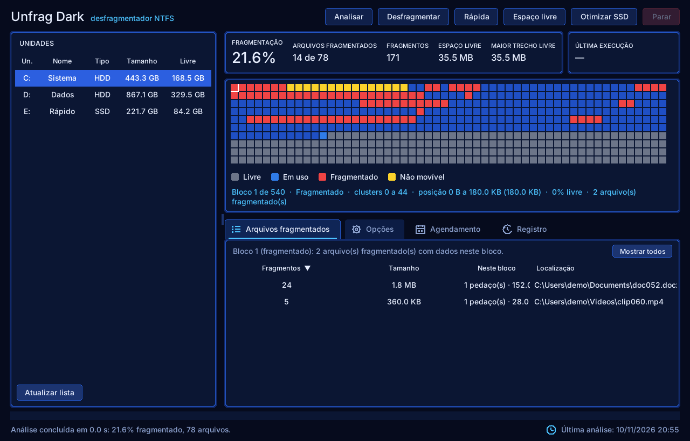
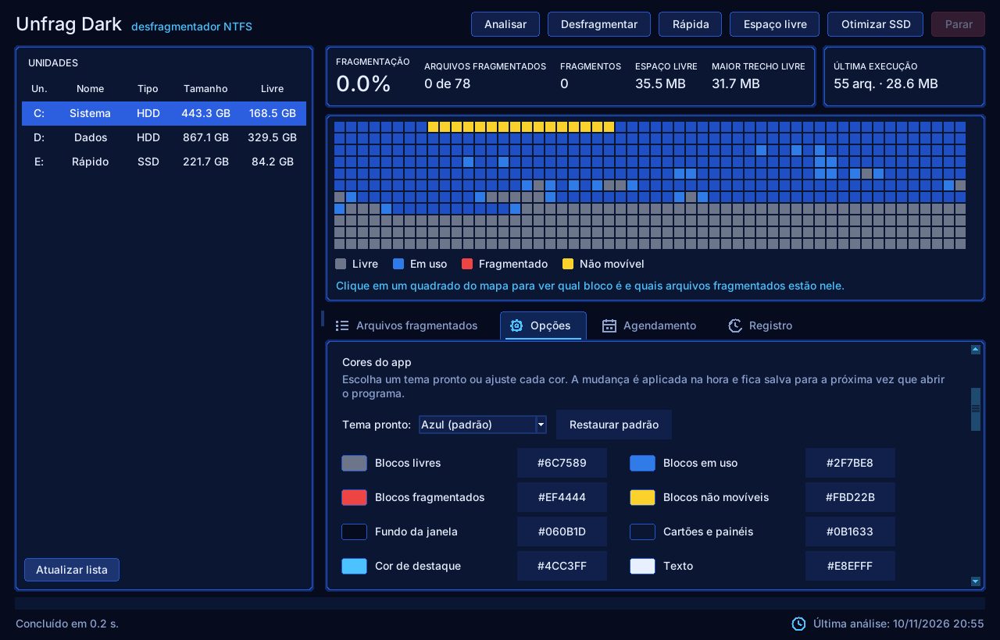
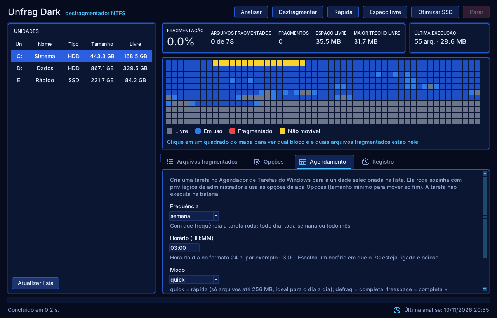
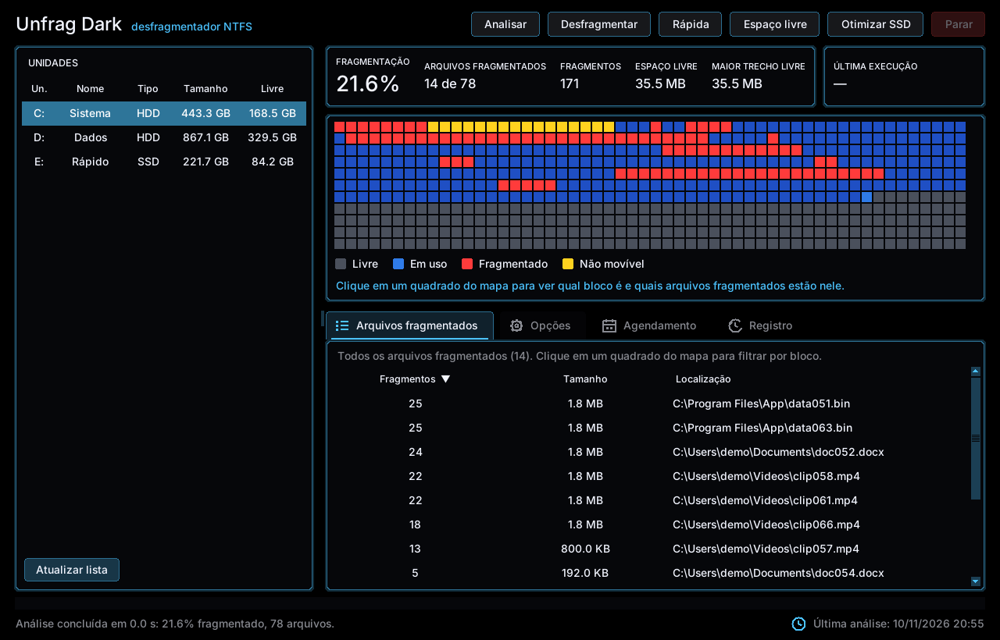

# Unfrag Dark


[](https://github.com/MissionBreak56/Unfrag-Dark-/actions/workflows/build.yml)
[](https://github.com/MissionBreak56/Unfrag-Dark-/actions/workflows/validate.yml)


Desfragmentador de disco **NTFS** para Windows 10/11, de código aberto, com **tema escuro** e mapa de disco
interativo. Projeto independente, escrito do zero em Python: não usa código, nome, ícones nem textos de
terceiros (veja [`docs/CLEAN-ROOM.md`](docs/CLEAN-ROOM.md)). Foi inspirado, em termos de *funcionalidades*,
em desfragmentadores clássicos para PC.


| Detalhe de um bloco do mapa | Depois de desfragmentar |
|---|---|
|  |  |

| Opções | Cores do app | Agendamento |
|---|---|---|
|  |  |  |

| Tema AMOLED (preto puro) |
|---|
|  |

> As capturas usam o **modo demo** (volumes simulados), então nenhum disco real foi tocado. Para refazê-las:
> `tools/make_screenshots.py`.

## Baixar e usar

* **Executáveis:** em [Releases](https://github.com/MissionBreak56/Unfrag-Dark-/releases) ou em
  *Actions → build → Artifacts* (`UnfragDark.exe` = interface gráfica, `unfrag.exe` = linha de comando).
  Os dois pedem permissão de administrador (UAC), que a API de desfragmentação exige.
* **Pelo Python** (3.10+):

```bat
pip install .
unfrag gui                 :: interface gráfica (execute como Administrador)
unfrag list
unfrag analyze C:
unfrag defrag C: --mode quick
```

**Teste sem risco, em qualquer sistema** (Windows, Linux ou macOS), com volumes simulados:

```bash
pip install .
unfrag --demo gui
unfrag --demo defrag C: --mode freespace
```

## Funções

| Função | Interface | Linha de comando |
|---|---|---|
| Listar unidades (tipo HDD/SSD, sistema de arquivos, espaço livre) | ✔ | `unfrag list` |
| Analisar a fragmentação sem alterar nada | **Analisar** | `unfrag analyze C:` |
| Desfragmentação completa | **Desfragmentar** | `unfrag defrag C:` |
| Desfragmentação rápida (arquivos até 256 MiB) | **Rápida** | `--mode quick` |
| Consolidar o espaço livre | **Espaço livre** | `--mode freespace` |
| Desfragmentar só uma pasta ou um arquivo | Opções / botão direito na lista | `--path "C:\Pasta"` |
| Mover arquivos grandes ou por extensão para o fim do disco | Opções | `--move-large 500` / `--move-ext .iso,.vhdx` |
| Mapa de disco (livre / em uso / fragmentado / não movível) | ✔ | — |
| **Clicar em um bloco do mapa:** detalhes do bloco e filtro da lista pelos arquivos que têm dados nele | ✔ | — |
| Lista de arquivos fragmentados, ordenável | ✔ | — |
| Proteção para SSD (não desfragmenta, a menos que forçado) | ✔ | `--force-ssd` |
| **Otimizar SSD (TRIM):** a manutenção certa para SSD, sem mover nem reescrever arquivos | **Otimizar SSD** | `unfrag trim C:` |
| Leitura direta da MFT para analisar mais rápido | Opções | `--mft` / `--no-mft` |
| Threads de leitura da análise (1–64; 0 = automático) | Opções | `--threads N` |
| Só executar se a fragmentação for ≥ X% | ✔ | `--min-frag 10` |
| Não executar na bateria / se certos programas estiverem abertos | ✔ | `--skip-battery` / `--exclude app.exe` |
| Desligar o PC ao terminar | ✔ | `--shutdown` |
| Agendamento diário/semanal/mensal (Agendador de Tarefas do Windows) | **Agendamento** | `unfrag schedule create C:` |
| Parar a qualquer momento, com cancelamento seguro | **Parar** | `Ctrl+C` |
| Bandeja do sistema: fechar a janela mantém o trabalho rodando; o ícone muda de cor (laranja = trabalhando, verde = concluído, vermelho = erro) | Opções | — |
| Iniciar com o Windows, minimizado na bandeja | Opções | — |
| Aviso do Windows ao terminar tarefas agendadas | automático | `--notify` |
| Temas prontos (Azul, Grafite, Esmeralda, Violeta, **AMOLED** com fundo preto puro) e cores individuais | Opções → Cores | — |
| Janela lembra tamanho, posição e se estava maximizada; instância única | automático | — |
| Resumo da última execução, inclusive as feitas por tarefa agendada | ✔ | — |
| Aviso de versão nova no GitHub (pode ser desligado) | Opções | — |

Cada botão tem uma explicação (passe o mouse sobre ele) e cada opção tem um texto explicativo na aba Opções.

## Como funciona

Usa as IOCTLs documentadas do Windows para desfragmentação online, as mesmas descritas pela Microsoft na
documentação de *Defragmenting Files*:

* `FSCTL_GET_VOLUME_BITMAP`: mapa de clusters livres e ocupados;
* `FSCTL_GET_RETRIEVAL_POINTERS`: extents de cada arquivo;
* `FSCTL_MOVE_FILE`: o próprio NTFS move os clusters e mantém a integridade dos dados;
* `IOCTL_STORAGE_QUERY_PROPERTY`: detecta SSD (sem penalidade de seek; se o driver não responde, usa o suporte a TRIM);
* `defrag.exe /L`: o TRIM do espaço livre (o mesmo da "Otimização de unidades" do Windows), usado só em SSD.

O algoritmo (`src/unfrag/engine.py`) é próprio:

* **Desfragmentar:** cada arquivo fragmentado é regravado em uma única corrida de espaço livre (*first-fit*),
  dos menores para os maiores.
* **Rápida:** igual, só para arquivos de até 256 MiB e sem consolidar o espaço livre.
* **Espaço livre:** a completa, e depois arquivos do fim do volume são puxados para os primeiros buracos que os
  comportam (até 4 passadas), juntando o espaço livre em um bloco grande no final.
* **Arquivos grandes ou por extensão** podem ser empurrados para o fim do disco.
* Antes de mover cada arquivo o motor confere o estado real dele no volume. Se algo mudou, o arquivo é
  ignorado; se o mapa local divergir do disco, o mapa é relido em vez de seguir com dados velhos.
* Vários nomes do mesmo arquivo (*hard links*, comuns em `WinSxS`) são reconhecidos e contados uma vez.
* Arquivos de sistema, esparsos, criptografados (EFS), compactados pelo NTFS, pontos de reanálise e arquivos
  que não abrem nunca são movidos (aparecem como ignorados, não como falhas).

## Velocidade

**Análise**

* **Leitura direta da MFT** (padrão; desligue em Opções ou com `--no-mft`): a análise do volume inteiro lê a
  MFT do NTFS em sequência em vez de abrir cada arquivo. No Windows de teste do CI (1,18 milhão de arquivos)
  levou 20 s contra 9 min 24 s do método clássico, com os mesmos extents. Se algo não puder ser lido com
  segurança, aquele arquivo (ou o volume todo) volta ao método clássico e o motivo vai para o Registro.
* O método clássico lê os arquivos em **várias threads** (Opções → *Threads de leitura*, `--threads N` ou
  `UNFRAG_THREADS=N`; automático: 2 por núcleo, até 16).
* Arquivos de até 1 cluster não podem fragmentar e só são contados, sem abrir.
* O mapa de clusters livres é interpretado por blocos homogêneos (≈10× mais rápido que bit a bit).
* O coletor de lixo do Python fica pausado durante a varredura e o buffer de extents é decodificado de uma
  vez, sem um `struct` por extent; objetos ctypes são reaproveitados por thread. Em um benchmark sintético
  (300 mil arquivos, só CPU) a análise caiu de ~2,7 s para ~1,3 s.
* A janela e a CLI mostram o tempo da análise.

**Modo Espaço livre**

* A busca de buracos usa dicas por classe de tamanho e pula direto para o primeiro trecho que comporta o
  arquivo (teste sintético com 200 mil trechos livres: ~112 s → ~7 s para 60 mil buscas, resultados idênticos).
* A compactação para quando não resta buraco antes dos arquivos que faltam.
* A verificação final relê só o mapa de espaço livre e os arquivos movidos, em paralelo. *Reanálise completa
  ao final* (Opções) ou `--full-rescan` (CLI) voltam ao comportamento de reanalisar o volume inteiro.
* O tempo restante é dominado pela cópia real dos clusters pelo NTFS, que depende do disco.

## Linha de comando

```bat
unfrag list
unfrag analyze C: [--path PASTA] [--no-recurse] [--threads N] [--mft | --no-mft]
unfrag defrag  C: [--mode defrag|quick|freespace] [--path PASTA] [--no-recurse]
                  [--move-large MB] [--move-ext .iso,.vhdx] [--min-frag PCT]
                  [--force-ssd] [--skip-battery] [--exclude APP.EXE] [--shutdown]
                  [--full-rescan] [--threads N] [--mft | --no-mft] [--notify]
unfrag trim    C: [--skip-battery] [--exclude APP.EXE] [--shutdown] [--notify]   # otimização de SSD
unfrag schedule create|delete C: [--frequency diária|semanal|mensal] [--time 03:00]
                  [--mode quick|defrag|freespace|trim] [--move-large MB] [--dry-run]
unfrag gui
unfrag --demo ...          # volumes simulados, não toca em discos
```

Exemplos:

```bat
unfrag defrag D: --mode freespace --move-large 1000 --skip-battery
unfrag schedule create C: --frequency semanal --time 03:00 --mode quick
unfrag schedule create E: --frequency semanal --time 03:00 --mode trim   # SSD
```

## Segurança, validação e privacidade

* **Faça backup.** O `FSCTL_MOVE_FILE` é a API oficial e segura do NTFS, mas qualquer ferramenta que mexe no
  disco pode encontrar falhas de hardware ou de energia.
* **Testes automatizados:** o motor (algoritmo, mapa livre, cancelamento, falhas, hard links, estado
  desatualizado, invariantes de integridade) é testado com um volume simulado, e a interface tem testes de
  fumaça (121 testes passam com interface gráfica; 87 sem ela).
* **Validação no Windows:** o workflow [`validar-no-windows`](.github/workflows/validate.yml) roda o programa de
  verdade em um Windows com NTFS, como administrador: compara a leitura da MFT com o método clássico, cria uma
  pasta de teste com arquivos fragmentados de propósito, desfragmenta e confere o SHA-256 de cada arquivo antes
  e depois, e testa a tarefa de início com o Windows. Isso roda em uma máquina virtual do GitHub, então **não
  substitui** testes em discos e hardware variados: comece por `analyze` e por uma pasta de teste (`--path`)
  antes de desfragmentar a unidade inteira.
* **SSD:** a desfragmentação é desnecessária e reduz a vida útil. O app recusa desfragmentar SSD (a checagem
  vem antes da análise) e oferece a **otimização TRIM** no lugar. Só `--force-ssd` (ou a opção em Opções, que
  vale só até fechar o programa) ignora isso. Se o tipo da unidade não puder ser identificado, o relatório avisa.
  Em outras unidades que não sejam NTFS fixas (pendrives, cartões), a linha de comando também se recusa a agir.
* **Privacidade:** tudo acontece localmente e não há telemetria. A única conexão de rede é a verificação de
  versão nova, que apenas lê o redirecionamento de `github.com/MissionBreak56/Unfrag-Dark-/releases/latest`
  (sem enviar dados). Dá para desligá-la em Opções → *Verificar atualizações ao iniciar*.
* Requer execução como Administrador.

## Desenvolvimento

```bash
pip install -e . pytest
pytest                      # os testes de interface só rodam com display
# Linux sem tela:  xvfb-run -a pytest
```

Estrutura de `src/unfrag/`:

| Módulo | Função |
|---|---|
| `engine.py` | algoritmo de análise e desfragmentação |
| `freespace.py` | mapa de espaço livre (corridas, first-fit com dicas) |
| `backends/windows.py` | API do Windows (bitmap, extents, mover clusters, SSD) |
| `backends/fake.py` | volume simulado para testes e `--demo` |
| `mft.py`, `ntfs.py` | leitura da MFT e decodificação de extents (partes puras, testáveis em qualquer sistema) |
| `scan.py` | varredura em paralelo com ordem preservada |
| `diskmap.py`, `palette.py` | mapa de blocos e paleta de cores |
| `gui.py`, `widgets.py` | interface Tkinter (cartões, abas, botões desenhados em Canvas) |
| `tray.py`, `notify.py`, `single.py`, `startup.py` | bandeja, avisos, instância única, início com o Windows |
| `updater.py` | verificação de versão no GitHub |
| `scheduler.py`, `system.py`, `cli.py` | agendamento, utilidades e linha de comando |

Ferramentas em `tools/`: `make_icon.py` (gera o ícone), `make_screenshots.py` (gera as capturas) e
`validate_windows.py` (validação no Windows real, usada pelo CI).

Veja também [`docs/ANALYSIS.md`](docs/ANALYSIS.md) (análise estática do instalador que motivou a lista de
funcionalidades) e [`docs/CLEAN-ROOM.md`](docs/CLEAN-ROOM.md).

## Licença

MIT. Veja [LICENSE](LICENSE).
